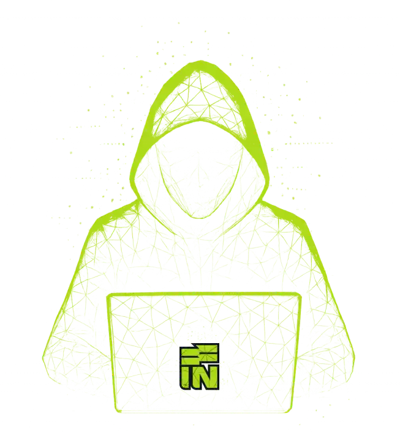
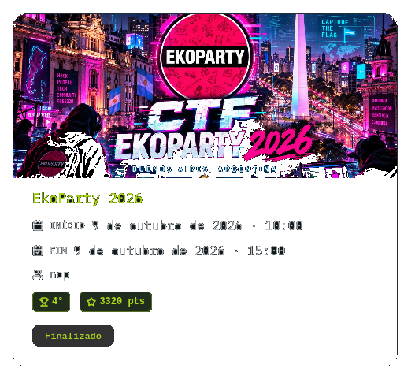
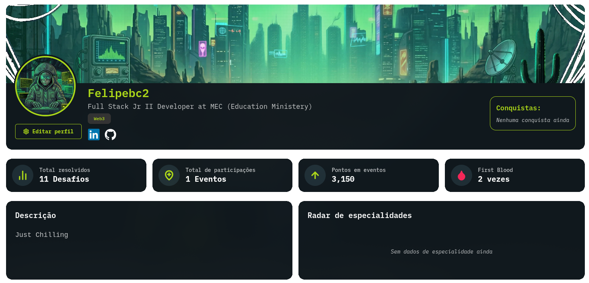
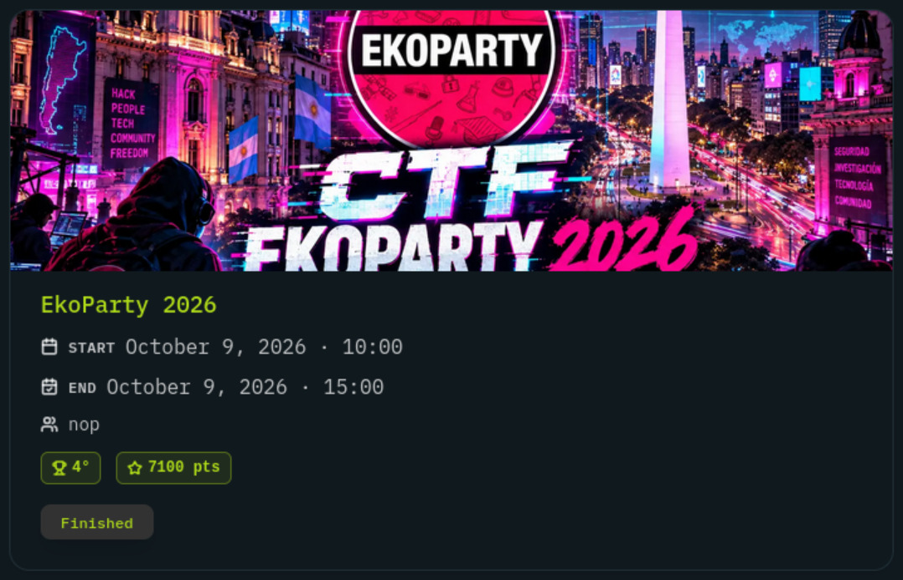
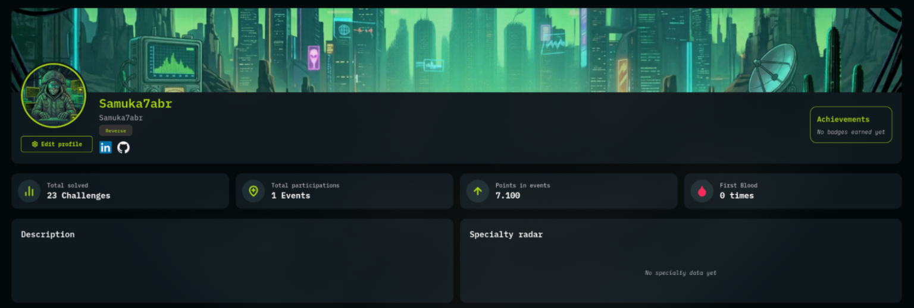
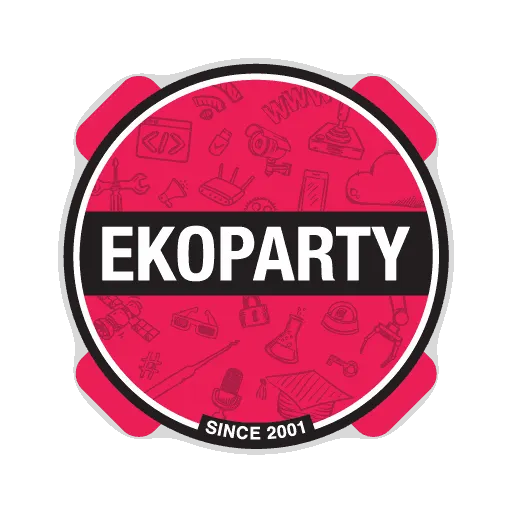

<b>🇧🇷 Português</b>

<h2>EKOPARTY 2026 — CTF</h2>

Writeups e artefatos dos desafios do <b>EkoParty 2026 CTF</b> (Hack in Cariri), Buenos Aires, Argentina.

  <b>Evento:</b> <code>app.hackincariri.com.br/events/de258172-f35b-4db2-b689-a7369edf8ac4</code> 
  <b>Data:</b> 9 de outubro de 2026 · 10:00–15:00 · <b>Finalizado</b>

<h3>Resultado</h3>
<table>
  <tr><th>Time</th><th>Colocação</th><th>Jogador</th><th>Especialidade</th><th>Pontos</th><th>Resolvidos</th><th>First Blood</th></tr>
  <tr><td rowspan="2"><code>nop</code></td><td rowspan="2"><b>4º</b></td><td><a href="https://github.com/Felipebc2">Felipebc2</a></td><td>Web3</td><td>3320</td><td>11</td><td>2</td></tr>
  <tr><td><a href="https://github.com/samuka7abr">Samuka7abr</a> (Samuel Abrão)</td><td>Reverse</td><td>7100</td><td>23</td><td>0</td></tr>
</table>

<h3>Desafios</h3>

Credenciais vivas (private keys, cookies de sessão) e endpoints de infra foram removidos/anonimizados
(<code>&lt;HOST&gt;</code>, <code>&lt;IP&gt;</code>, <code>&lt;RPC&gt;</code>, <code>&lt;PORT&gt;</code>). Flags e metodologia mantidas. 
Status: ✅ resolvido · 🟡 em aberto.

As tabelas de desafios (nomes, pontos e status) estão na seção em inglês abaixo e valem para todos os idiomas.

<b>🇦🇷 Español</b>

<h2>EKOPARTY 2026 — CTF</h2>

Writeups y artefactos de los desafíos del <b>EkoParty 2026 CTF</b> (Hack in Cariri), Buenos Aires, Argentina.

  <b>Evento:</b> <code>app.hackincariri.com.br/events/de258172-f35b-4db2-b689-a7369edf8ac4</code> 
  <b>Fecha:</b> 9 de octubre de 2026 · 10:00–15:00 · <b>Finalizado</b>

<h3>Resultado</h3>
<table>
  <tr><th>Equipo</th><th>Posición</th><th>Jugador</th><th>Especialidad</th><th>Puntos</th><th>Resueltos</th><th>First Blood</th></tr>
  <tr><td rowspan="2"><code>nop</code></td><td rowspan="2"><b>4º</b></td><td><a href="https://github.com/Felipebc2">Felipebc2</a></td><td>Web3</td><td>3320</td><td>11</td><td>2</td></tr>
  <tr><td><a href="https://github.com/samuka7abr">Samuka7abr</a> (Samuel Abrão)</td><td>Reverse</td><td>7100</td><td>23</td><td>0</td></tr>
</table>

<h3>Desafíos</h3>

Las credenciales activas (private keys, cookies de sesión) y los endpoints de infraestructura fueron eliminados/anonimizados
(<code>&lt;HOST&gt;</code>, <code>&lt;IP&gt;</code>, <code>&lt;RPC&gt;</code>, <code>&lt;PORT&gt;</code>). Se mantienen las flags y la metodología. 
Estado: ✅ resuelto · 🟡 pendiente.

Las tablas de desafíos (nombres, puntos y estado) están en la sección en inglés más abajo y aplican a todos los idiomas.

<h1>EKOPARTY 2026 — CTF</h1>

Writeups and artifacts for the <b>EkoParty 2026 CTF</b> (Hack in Cariri) challenges, Buenos Aires, Argentina.

  <b>Event:</b> <code>app.hackincariri.com.br/events/de258172-f35b-4db2-b689-a7369edf8ac4</code> 
  <b>Date:</b> October 9, 2026 · 10:00–15:00 · <b>Finished</b>

<h2>Result</h2>
<table>
  <tr><th>Team</th><th>Rank</th><th>Player</th><th>Specialty</th><th>Points</th><th>Solved</th><th>First Blood</th></tr>
  <tr><td rowspan="2"><code>nop</code></td><td rowspan="2"><b>4th</b></td><td><a href="https://github.com/Felipebc2">Felipebc2</a></td><td>Web3</td><td>3320</td><td>11</td><td>2</td></tr>
  <tr><td><a href="https://github.com/samuka7abr">Samuka7abr</a> (Samuel Abrão)</td><td>Reverse</td><td>7100</td><td>23</td><td>0</td></tr>
</table>

<h3>Felipebc2</h3>

<h3><a href="https://github.com/samuka7abr">Samuel Abrão</a> — Samuka7abr</h3>

<h2>Challenges</h2>

Live credentials (private keys, session cookies) and infrastructure endpoints were removed/anonymized
(<code>&lt;HOST&gt;</code>, <code>&lt;IP&gt;</code>, <code>&lt;RPC&gt;</code>, <code>&lt;PORT&gt;</code>). Flags and methodology kept. 
Status: ✅ solved · 🟡 open.

<h3>Malware</h3>
<table>
  <tr><th>Challenge</th><th>Pts</th><th>Status</th></tr>
  <tr><td><a href="Malware-AfterHours/">After Hours</a></td><td>150</td><td>✅</td></tr>
  <tr><td><a href="Malware-BuildStamp/">Build Stamp</a></td><td>100</td><td>✅</td></tr>
  <tr><td><a href="Malware-TheUpdater/">The Updater</a></td><td>200</td><td>✅</td></tr>
  <tr><td><a href="Malware-AfterReboot/">After Reboot</a></td><td>300</td><td>🟡</td></tr>
  <tr><td><a href="Malware-SecondObject/">Second Object</a></td><td>250</td><td>🟡</td></tr>
  <tr><td><a href="Malware-StillResident/">Still Resident</a></td><td>350</td><td>🟡</td></tr>
  <tr><td><a href="Malware-GarbledLine/">Garbled Line</a></td><td>400</td><td>🟡</td></tr>
  <tr><td><a href="Malware-NewDialect/">New Dialect</a></td><td>450</td><td>🟡</td></tr>
  <tr><td><a href="Malware-OpenConsole/">Open Console</a></td><td>500</td><td>🟡</td></tr>
  <tr><td><a href="Malware-SameDesk/">Same Desk</a></td><td>600</td><td>🟡</td></tr>
</table>

<h3>Web3</h3>
<table>
  <tr><th>Challenge</th><th>Pts</th><th>Status</th></tr>
  <tr><td><a href="Web3-AssemblyFloor/">Assembly Floor</a></td><td>400</td><td>✅</td></tr>
  <tr><td><a href="Web3-NightDeposit/">Night Deposit</a></td><td>350</td><td>✅</td></tr>
  <tr><td><a href="Web3-VoucherWindow/">Voucher Window</a></td><td>400</td><td>✅</td></tr>
  <tr><td><a href="Web3-MaintenanceHatch/">Maintenance Hatch</a></td><td>500</td><td>✅</td></tr>
  <tr><td><a href="Web3-CarcaraMarkets/">Carcara Markets</a></td><td>450</td><td>🟡</td></tr>
</table>

<h3>Packet / Net</h3>
<table>
  <tr><th>Challenge</th><th>Pts</th><th>Status</th></tr>
  <tr><td><a href="Net-FrontDesk/">Front Desk</a></td><td>150</td><td>🟡</td></tr>
  <tr><td><a href="Net-Helpdesk/">Helpdesk</a></td><td>300</td><td>✅</td></tr>
  <tr><td><a href="Net-DutyRoster/">Duty Roster</a></td><td>350</td><td>✅</td></tr>
  <tr><td><a href="Net-LongCall/">Long Call</a></td><td>200</td><td>✅</td></tr>
  <tr><td><a href="Net-BackgroundNoise/">Background Noise</a></td><td>—</td><td>🟡</td></tr>
  <tr><td><a href="Net-Outbox/">Outbox</a></td><td>300</td><td>🟡</td></tr>
  <tr><td><a href="Net-LookupDesk/">Lookup Desk</a></td><td>300</td><td>🟡</td></tr>
</table>

<h3>Reverse</h3>
<table>
  <tr><th>Challenge</th><th>Pts</th><th>Status</th></tr>
  <tr><td><a href="Rev-ButterflyEffect/">Butterfly Effect</a></td><td>250</td><td>✅</td></tr>
  <tr><td><a href="Rev-ClockWatch/">Clock Watch</a></td><td>600</td><td>✅</td></tr>
  <tr><td><a href="Rev-WrappedSample/">Wrapped Sample</a></td><td>400</td><td>✅</td></tr>
  <tr><td><a href="Rev-LastSample/">Last Sample</a></td><td>750</td><td>✅</td></tr>
</table>

<h3>Web</h3>
<table>
  <tr><th>Challenge</th><th>Pts</th><th>Status</th></tr>
  <tr><td><a href="Web-CertificateExchange/">Certificate Exchange</a></td><td>200</td><td>✅</td></tr>
  <tr><td><a href="Web-MyNotes/">My Notes</a></td><td>200</td><td>✅</td></tr>
</table>

<h3>Pwn / Binary Exploitation</h3>
<table>
  <tr><th>Challenge</th><th>Pts</th><th>Status</th></tr>
  <tr><td><a href="Pwn-BinaryGecko1/">First Chall by Binary Gecko</a></td><td>200</td><td>🟡</td></tr>
  <tr><td><a href="Pwn-BinaryGecko2/">Second Chall by Binary Gecko</a></td><td>400</td><td>🟡</td></tr>
  <tr><td><a href="Pwn-ZMjs/">ZM.js</a></td><td>400</td><td>✅</td></tr>
</table>

<h3>Game</h3>
<table>
  <tr><th>Challenge</th><th>Pts</th><th>Status</th></tr>
  <tr><td><a href="Game-DarkSouls/">Dark Souls</a></td><td>500</td><td>🟡</td></tr>
</table>

